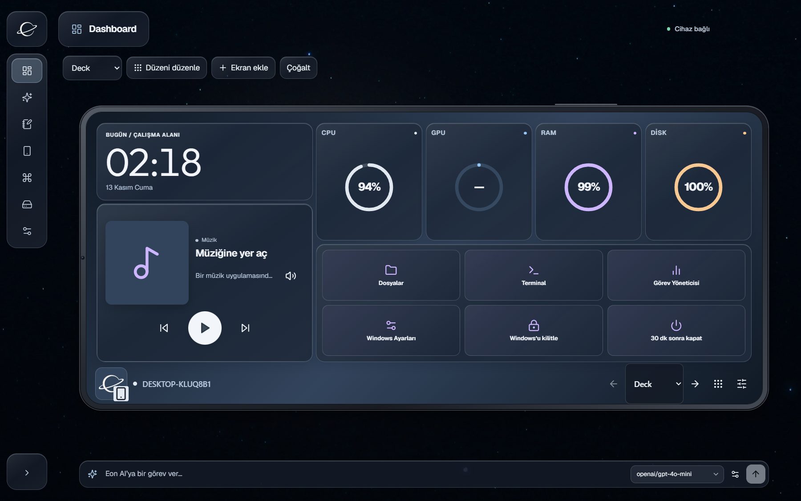
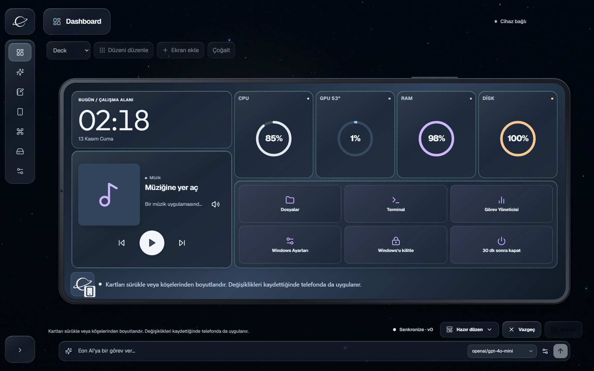
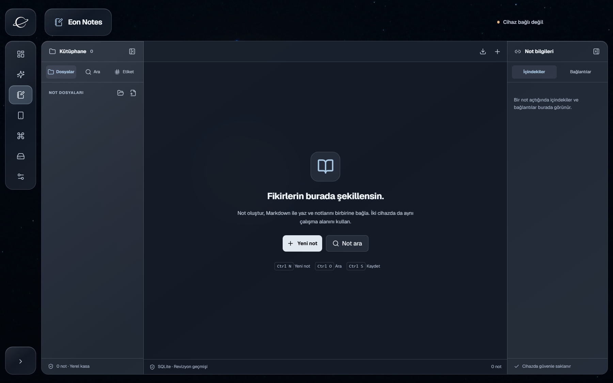
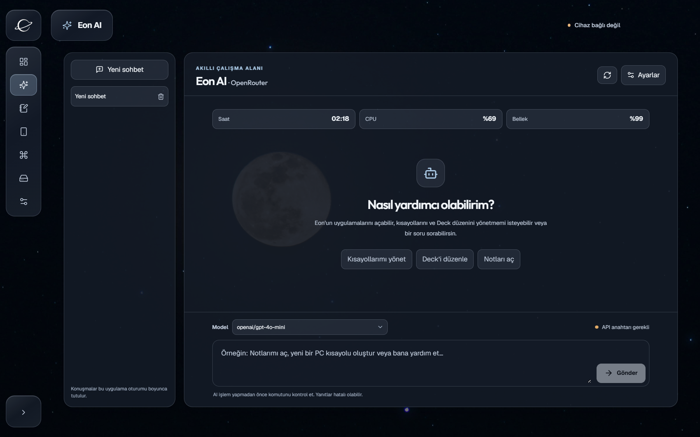
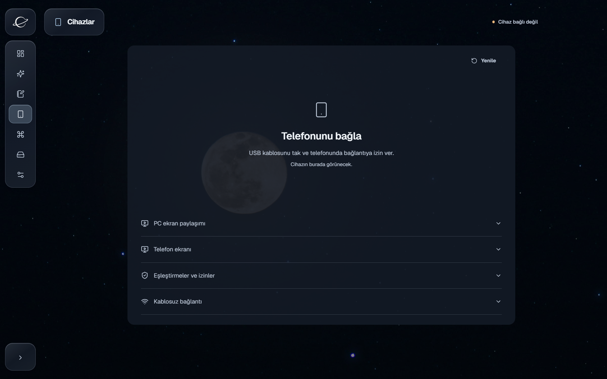
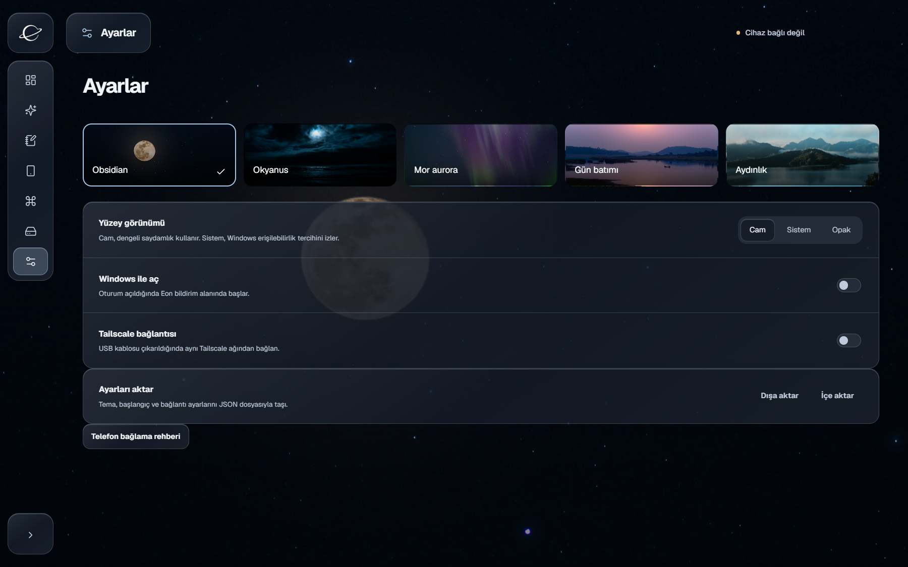

<div align="center">
  
  <h1>Eon 2</h1>
  <p><strong>Bilgisayarın ve telefonun. Aynı çalışma alanı.</strong></p>
  <p>Kişiselleştirilebilir Deck, bağlantılı notlar, Eon AI ve cihaz kontrolü.</p>
  <p>Windows x64 · Android 8.0+ · Türkçe · Açık kaynak</p>
  <p><a href="https://github.com/geniusprr/Eon/releases/tag/v2.0.0-preview.1"><strong>Eon 2 ön sürümünü indir</strong></a> · <a href="docs/USAGE.tr.md">Kullanım rehberi</a> · <a href="#geliştirme">Geliştirme</a></p>
</div>



> **v2.0.0-preview.1 — Eon 2'nin ilk ön sürümü.** Bu bir kararlı sürüm değildir. Windows paketi kod imzasızdır; Android companion geliştirme anahtarıyla imzalanmıştır. Önceki v1 yayınları korunur. [Doğrulama ve sınırlar](docs/eon2/RELEASE-20261113.md).

## Eon ile neler yapabilirsin?

Eon, Windows bilgisayarını ve Android telefonunu ortak bir çalışma alanında buluşturur. Masaüstünde düzenlediğin Deck'i telefonda kullanabilir, notlarınla çalışabilir, izin verdiğin PC kısayollarını çalıştırabilir ve dosya aktarabilirsin. USB ile başla; kablosuz kullanım için isteğe bağlı Tailscale bağlantısını yapılandır.

| Alan | Güncel Eon 2 deneyimi |
| --- | --- |
| **Deck / Dashboard** | Düzenlenebilir kartlar, birden fazla ekran, sistem göstergeleri, saat, medya ve hızlı eylemler |
| **Eon Notes** | Markdown düzenleme, klasörler, not geçmişi ve çakışma çözümü |
| **Eon AI** | OpenRouter hesabı veya API anahtarı, model seçimi ve uygulama araçları |
| **Cihazlar** | USB cihaz keşfi, Android kurulumu, eşleştirme ve cihaz başına izinler |
| **PC Kısayolları** | Telefonda kullanılabilecek eylemleri seçme ve düzenleme |
| **Dosya Aktarımı** | İzin verilen cihazlarla çift yönlü aktarım ve hedef klasör seçimi |
| **Ekran bağlantısı** | scrcpy ile Android ekranı; ayrı oturum onayıyla PC ekranı ve kontrolü |
| **Ayarlar** | Beş tema, Cam / Sistem / Opak yüzeyler, başlangıç ve ayar aktarımı |

## Kendine ait bir Deck

Dashboard'daki panel düzenleyicisini aç, kartları taşı ve boyutlandır; düzeni kaydet. Ekran seçicisiyle paneller arasında geç. **Kısayollar** ekranında eylemleri seçip sırala. Masaüstü ve Android aynı Deck düzen sözleşmesini kullanır.



## Notlarına yer aç

Eon Notes'ta not oluştur, Markdown ile yaz ve geçmişini incele. Aynı not iki cihazda farklı düzenlendiğinde çakışmayı gözden geçir. Eon 2'nin SQLite not deposu eski v1 Vault klasöründen ayrıdır; **otomatik v1 geçişi sunulmaz**. Önemli notlarının ayrıca yedeğini tut.



## Eon AI ile çalış

Eon AI bölümündeki OpenRouter ayarlarından hesabını bağla veya kendi API anahtarını ekle. Model seçerek sohbet et. Model kullanımı sağlayıcının ücretlerine ve internet bağlantısına bağlıdır. İstek içeriği OpenRouter'a ve seçilen model sağlayıcısına gönderilir.



## Bağlantıların senin kontrolünde

USB üzerinden telefonunu bul, Eon companion'ı kur ve eşleştirme isteğini diğer cihazda kabul et. Not, aktarım ve kontrol izinlerini **Cihazlar** bölümünden yönet. Android ekranı için USB hata ayıklama yetkisi gerekir; PC ekranı oturumu ayrıca masaüstü onayı ister.



## Açık veya koyu, sana göre

Obsidian, Okyanus, Mor aurora, Gün batımı ve Aydınlık temaları arasından seçim yap. Cam, Sistem ve Opak yüzey seçeneklerini Ayarlar'dan değiştir.



## İndir ve başla

1. [Eon 2 ön sürüm sayfasından](https://github.com/geniusprr/Eon/releases/tag/v2.0.0-preview.1) `Eon-Setup-2.0.0-preview.1.exe` dosyasını indir ve kur. Windows 10/11 x64 gerekir.
2. Eon'u aç. Telefon olmadan Dashboard, yerel notlar ve ayarlarla başlayabilirsin.
3. Telefonda geliştirici seçeneklerinden **USB hata ayıklama**yı aç; veri kablosuyla bağla ve bilgisayarın hata ayıklama isteğini telefonda onayla.
4. Eon → **Cihazlar** bölümünden **Eon'u kur** seçeneğini kullan. Alternatif olarak yayındaki `Eon-Android-preview.apk` dosyasını telefona kur.
5. Eon iki cihazda açıkken **Eşleştir**'i seç ve isteği diğer cihazda kabul et. Gerekli izinleri aç.
6. Telefonda yön işaretli Eon düğmesiyle yatay Deck'e geç. Ekranlar arasında kaydır veya ekran seçicisini kullan.

**[→ Ayrıntılı kullanım, bağlantı sorunları ve yedekleme rehberi](docs/USAGE.tr.md)**

Windows paketi Authenticode imzası taşımaz; SmartScreen yayıncı uyarısı gösterebilir. Android paketi `com.kapanis.mobil.eon2.dev` kimliğiyle kurulur. Bu bir Play Store veya Android üretim sürümü değildir.

## Veriler ve bağlantı modeli

Notlar ve uygulama durumu yerel olarak saklanır. USB bağlantısı uygulama kimlik doğrulaması kullanır; bu tek başına ağ şifrelemesi anlamına gelmez. Tailscale için aynı tailnet, uygun HTTPS sertifikası ve uygulama eşleştirmesi gerekir. Bağlantı portlarını internete açma.

Eon 2'nin varsayılan çalışma yolu eski tarayıcı, LibreChat ve Supabase arayüzlerini başlatmaz. Depoda tutulan eski kaynaklar güncel ürün özellikleri olarak tanıtılmaz. Dahili `kapanis` kimliklerinin bir kısmı uyumluluk için korunur.

## Geliştirme

Node.js 22+, npm ve Windows gerekir. Android derlemesi için SDK 37 ve Gradle 9.5 / AGP 9.3 ile uyumlu JDK gerekir. Bu yayının yerel derlemesi Android Studio JBR ile yapılmıştır.

```powershell
npm ci
npm run dev
```

| Komut | İşlev |
| --- | --- |
| `npm run build` | React, TypeScript ve Electron derlemesi |
| `npm run test:eon2` | Güncel Eon 2 servis, protokol ve düzen testleri |
| `npm test` | Korunan v1 test grubu |
| `npm run dist` | Android ve scrcpy kaynaklarıyla Windows NSIS paketi |

`npm run dev:ui` yalnızca renderer önizlemesidir; cihaz ve Windows servisleri için `npm run dev` gerekir. Paketleme öncesinde `ANDROID_HOME`, `JAVA_HOME` ve tam scrcpy dağıtımının yolunu (`EON_SCRCPY_DIST_DIR` veya PATH) ayarla. [Derleme ayrıntıları](docs/eon2/RELEASE-20261113.md).

```text
src/eon2/            Güncel masaüstü arayüzü
electron/eon2/       Yerel servisler, cihaz ve not altyapısı
mobil/              Android Compose companion
packages/notes-sync/ Ortak not revizyon protokolü
shared/             Tipli platform sözleşmeleri
docs/               Kullanım ve doğrulama kayıtları
```

## Katkı ve lisans

Sorun bildirirken uygulama sürümünü, işletim sistemini, bağlantı türünü ve tekrar adımlarını [GitHub Issues](https://github.com/geniusprr/Eon/issues) bölümüne ekle. Ekran görüntülerinden kişisel bilgileri ve anahtarları kaldır.

[MIT](LICENSE). Paketlenen üçüncü taraf bileşenler kendi lisanslarına tabidir; dağıtımlarındaki bildirimleri koruyun.
